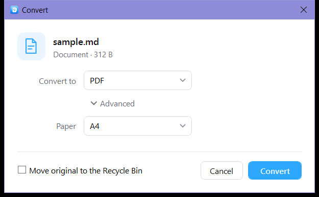

# Convert for Windows

Like CloudConvert, but local. Drop files on the window, pick a format, convert — audio,
video, images, documents and PDFs, without uploading anything to a server.



This is a Windows port of the macOS app [newtonstudios/convert](https://github.com/newtonstudios/convert),
written in C# / WPF. The interface, behaviour and shortcuts follow the original.

## Features

| Kind | Read | Write |
| --- | --- | --- |
| **Audio** | anything ffmpeg can read (MP3, M4A, WAV, FLAC, OGG, Opus, WMA, AIFF, AC3…) | MP3, M4A (AAC), M4A (HE-AAC)\*, WAV, AIFF, FLAC, ALAC, Opus, OGG, WMA, AC3, WavPack, MP2 |
| **Video** | anything ffmpeg can read (MP4, MOV, MKV, WebM, AVI, M4V…) | MP4 (H.264/HEVC/AV1), MOV (ProRes 422), WebM (VP9), MKV, GIF |
| **Images** | JPEG, PNG, HEIC, TIFF, BMP, GIF, WebP, AVIF, ICO | JPEG, PNG, WebP, AVIF, TIFF, GIF, BMP, PDF |
| **Documents** | DOCX, ODT, RTF, HTML, Markdown, plain text | PDF, DOCX, ODT, RTF, HTML, plain text |
| **PDF** | any PDF | PNG or JPEG (one file per page), plain text |

\* HE-AAC appears when the installed ffmpeg includes `libfdk_aac` (the gyan.dev *full* build does; the automatically downloaded *essentials* build does not).

- Batch conversion: mix files of the same kind and convert them all at once.
- Drag and drop, `Ctrl+O`, or right-click files in Explorer → **Convert with Convert…**.
- Advanced options per format: quality, bitrate, resolution, sample rate, frame rate, codec,
  hardware encoding, paper size, and "move originals to the Recycle Bin".
- All processing is local. Nothing is uploaded.

## Install

Download `Convert-win-x64.zip` from the releases page, unzip it anywhere, and run
`Convert.exe`. The build is self-contained: no .NET installation is needed.

Then, optionally, enable the Explorer entry from the app (`Add to right-click menu`), or run:

```powershell
Convert.exe --install-menu
Convert.exe --uninstall-menu
```

> On Windows 11 the entry appears under **Show more options** (or press `Shift+F10`).

### Requirements

- Windows 10 1809 or newer, 64-bit (x64 or arm64).
- **Microsoft Edge WebView2** for documents → PDF. It ships with Windows 11 and with Edge
  on Windows 10, so it is almost always present already.
- **LibreOffice** (optional) for reading/writing Word 97–2004 `.doc` files, the only format
  Windows cannot handle on its own.

### ffmpeg

Audio, video, WebP and AVIF use ffmpeg. If it isn't on your `PATH`, the app downloads a
static build from [gyan.dev](https://www.gyan.dev/ffmpeg/builds/) on first use and keeps it in
`%LOCALAPPDATA%\Convert\bin`. Nothing else is installed system-wide. You can also point the
app at your own copy with the `CONVERT_FFMPEG` and `CONVERT_FFPROBE` environment variables.

## Build from source

You need the [.NET 8 SDK](https://dotnet.microsoft.com/download/dotnet/8.0) on Windows:

```powershell
git clone https://github.com/<you>/convert-windows.git
cd convert-windows
.\build.ps1                # self-contained win-x64 build in .\publish\win-x64
.\build.ps1 -Runtime win-arm64
```

Or simply:

```powershell
dotnet build src\Convert\Convert.csproj
dotnet run --project src\Convert\Convert.csproj -- "C:\path\to\file.mp3"
```

## Command line

```text
Convert.exe [file…]                       opens the Convert window with those files
Convert.exe --cli <target> <file…>        converts with default settings
Convert.exe --install-menu                adds the Explorer right-click entry
Convert.exe --uninstall-menu              removes it
Convert.exe --help
```

Examples:

```powershell
Convert.exe --cli pdf-doc report.docx
Convert.exe --cli mp3 song.flac
Convert.exe --cli png photo.heic
Convert.exe --cli pdf-txt scan.pdf
```

`--cli` prints one `OK` or `FAIL` line per file and exits non-zero if any file failed.
Settings can be overridden with a JSON object in `CONVERT_SETTINGS`, for example:

```powershell
$env:CONVERT_SETTINGS = '{"ImageQuality":0.8,"MaxSize":1920,"AudioBitrate":192}'
Convert.exe --cli jpg photo.png
```

## How it works

macOS gives the original app AVFoundation, ImageIO, PDFKit and `textutil`. Windows has
different building blocks, so the port maps them like this:

| Original (macOS) | Windows port |
| --- | --- |
| AVFoundation / `ffmpeg` | **ffmpeg** (downloaded on demand) |
| ImageIO, `cwebp` | **WIC** (Windows Imaging Component) + ffmpeg for WebP/AVIF/HEIC |
| PDFKit rendering | **Windows.Data.Pdf** |
| PDFKit text extraction | **PdfPig** |
| `textutil` | a small document model: **Open XML SDK** (DOCX), **ODT zip + XML**, an **RTF reader**, **HtmlAgilityPack**, and a Markdown renderer |
| PDF printing | **WebView2** `PrintToPdfAsync` |
| Finder Quick Action | **Explorer verb** under `HKCU\Software\Classes\*\shell\Convert` |
| Sandboxed app bundle | plain folder in `%LOCALAPPDATA%\Convert` for settings and ffmpeg |

Hardware video encoding (NVENC, Quick Sync, AMF) is probed at runtime by actually encoding a
short test clip; when the driver refuses, the app silently falls back to software encoding.

## Differences from the macOS version

- HEIC **output** is not offered: Windows has no reliable HEIC encoder and ffmpeg's is
  experimental. HEIC **input** works (WIC codec when installed, ffmpeg otherwise).
- `.doc` (Word 97–2004) needs LibreOffice, which is optional; other formats need nothing.
- The Explorer entry is per-user, so it needs no administrator rights. On Windows 11 it lives
  under **Show more options**.

## License

MIT — see [LICENSE](LICENSE). The original macOS app is © Newton Studios, also MIT licensed.
ffmpeg is a separate program, downloaded at runtime and governed by its own license.
